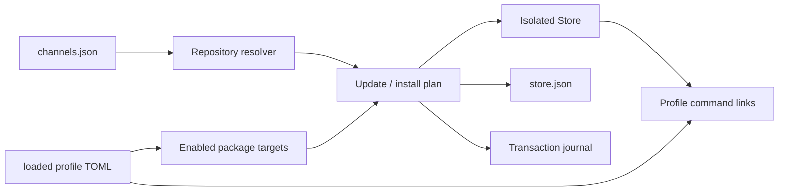

# NixNet

<p align="center">
  <a href="https://go.dev/"></a>
  <a href="https://www.kernel.org/"></a>
  <a href="https://termux.dev/"></a>
  <a href="https://github.com/oversonv/nixnet/blob/main/LICENSE"></a>
  <a href="https://github.com/oversonv/nixnet"></a>
</p>

<p align="center">
  <strong>A profile-based package manager for Linux and Android/Termux</strong><br>
  Isolated Store • independent environments • PATH command management
</p>

<p align="center">
  <a href="#quick-start"><code>Quick Start</code></a>
  · <a href="#profiles"><code>Profiles</code></a>
  · <a href="#configuration"><code>Configuration</code></a>
  · <a href="#build"><code>Build</code></a>
  · <a href="docs/ARCHITECTURE.md"><code>Architecture</code></a>
</p>

NixNet installs native Debian binary packages (`.deb`) from APT repositories into a private, isolated Store. The active package set is determined by the loaded profile, not by a global enabled list.

- Linux and Android/Termux support.
- Independent profiles with concrete package versions.
- Repository configuration through `channels.json`.
- Separate persistent-default and currently-loaded profiles.
- Bidirectional synchronization of profile commands with `PATH`.
- Atomic transactions, recovery journaling, and process locking.
- SHA-256, dependency, archive, and Store verification.

> [!IMPORTANT]
> Package payloads remain in the private Store. Only commands from the enabled list of the currently loaded profile are published to `PATH`.

## Quick Start

### Install a prebuilt ARM64 release

Linux ARM64 and Android/Termux ARM64 can install the latest development build without Python or `jq`:

```sh
curl -fsSL https://raw.githubusercontent.com/oversonv/nixnet/main/install.sh | sh
```

The installer uses `curl` or `wget` to download the matching binary. Termux installs to `$PREFIX/bin`; Linux installs to `$HOME/.local/bin`.

### Linux

```sh
go build -o nixnet ./cmd/nixnet
./nixnet channel list
./nixnet channel install https://example.org/apt/stable
./nixnet env install example:package==1.2.3
./nixnet profiles list
```

### Termux / Android

```sh
pkg install golang gpgv xz
GOOS=android GOARCH=arm64 go build -o nixnet ./cmd/nixnet
./nixnet channel list
./nixnet profiles list
```

On Android, the binary publishes managed links under `$PREFIX/bin`. On regular Linux, links use `$HOME/nix/bin`, which must be added to `PATH`.

## Build

Requirements:

- Go 1.20 or newer.
- `gpgv` to verify signed APT `Release` files.
- A trusted repository public key.
- `xz` for XZ-compressed indexes or archives. Plain, gzip, and bzip2 streams are handled internally.

```sh
go test ./...
go test -race ./...
go vet ./...
go build -o nixnet ./cmd/nixnet
```

Select a target architecture with standard Go environment variables:

```sh
GOOS=linux GOARCH=amd64 go build -o nixnet ./cmd/nixnet
GOOS=android GOARCH=arm64 go build -o nixnet ./cmd/nixnet
GOOS=android GOARCH=arm go build -o nixnet ./cmd/nixnet
```

## Profiles

A profile is an independent working environment with its own package list. Payload files remain in the shared Store; a profile declares exact roots in `name==version` format. NixNet resolves those roots into a profile-owned dependency closure pinned to verified Store artifacts. Identical artifacts may be shared physically, but a package from another profile is not implicitly considered installed in this one.

```text
profiles.lock  ──► persistent default profile
.current       ──► currently loaded profile
profiles/*.toml ─► enabled packages for each profile
profiles/<name>/.generation ─► active immutable generation
```

| File / marker | Purpose |
|---|---|
| `profiles.lock` | Persistent default profile used by `profiles update` without a name |
| `.current` | Profile targeted by `env` commands and published to `PATH` |
| `<name>.toml` | Independent enabled package list |
| `<name>/.generation` | Active generation ID for the profile |
| `<name>/generations/*.json` | Immutable roots and Store closure snapshots |

### Example profile

```toml
[profile]
enabled = [
  "neofetch==7.1.0-1",
]
```

```sh
nixnet profiles install work       # create an empty profile without installing packages
nixnet profiles update work        # apply and load work
nixnet profiles update             # apply the persistent default from profiles.lock
nixnet profiles list               # mark the default and list profiles
nixnet profiles generations work   # list retained profile generations
nixnet profiles rollback work <id>  # restore a generation without network access
nixnet profiles remove work        # atomically remove profile state
```

`profiles update work` does not modify `profiles.lock`: a named profile update affects only the loaded environment.

Each new profile starts with an empty generation. Successful package, freeze, and profile updates record immutable manifests under `profiles/<name>/generations/`. Rollback verifies every referenced Store artifact before changing the profile. Generations are retained until the profile is removed; NixNet does not prune them automatically.

## Configuration

All mutable state is stored under `$HOME/nix/`:

```text
$HOME/nix/
├── store/                  # Isolated package directories
├── staging/                # Temporary atomic transaction data
├── bin/                    # Command-link directory on regular Linux
├── set/
│   ├── channels.json       # Sole repository configuration source
│   ├── store.json          # Shared artifact index and per-profile resolved closures
│   ├── transaction.json    # Unfinished transaction journal
│   └── nixnet.lock        # Process lock
└── profiles/
    ├── profiles.lock       # Persistent default profile
    ├── .current            # Currently loaded profile
    ├── <name>.toml         # Profile enabled packages
    └── <name>/
        ├── .generation     # Current generation ID
        └── generations/    # Immutable profile state manifests
```

| Source | Role |
|---|---|
| `channels.json` | Repository and APT download configuration |
| `<name>.toml` | Active package targets for a selected profile |
| `store.json` | Shared verified artifact index and profile-to-artifact closure references |
| `profiles.lock` | Default profile for commands without a profile name |
| `.current` | Profile that determines published commands |

During the initial migration, legacy `settings.toml` is retained as `settings.toml.migrated` or a numbered variant. `settings.toml` is no longer runtime configuration.

## Repositories

`channels.json` is the sole active repository configuration source. The channel list preserves order and repository fields:

```json
{
  "channels": [
    {
      "name": "main",
      "url": "https://mirror.example/apt/stable",
      "distribution": "stable",
      "component": "main",
      "architecture": "amd64"
    }
  ]
}
```

On Android builds, NixNet may create the official Termux channel automatically:

```json
{
  "name": "termux",
  "url": "https://packages-cf.termux.dev/apt/termux-main",
  "distribution": "stable",
  "component": "main"
}
```

NixNet loads `dists/<distribution>/Release`, verifies the signature with `gpgv`, and downloads a Packages index only when it matches the signed size and SHA-256 metadata.

## Installation and Store

NixNet reads the Debian `ar` container, then `control.tar*` and `data.tar*`, validating package name, version, architecture, paths, symlinks, hardlinks, dependencies, and file checksums. Each downloaded `.deb` is verified against the signed APT Packages index SHA-256.

Package payloads are extracted into a content-addressed Store. Files are not copied into a home profile or maintained as copies inside profiles.

### Platform behavior

| Platform | Managed links | Notes |
|---|---|---|
| Linux | `$HOME/nix/bin` | The directory must be added to `PATH` |
| Android / Termux | `$PREFIX/bin` | Managed links are placed in the standard Termux `PATH` |

At startup and after profile switching, NixNet compares the complete desired link set with existing NixNet-managed links. Third-party binaries and links outside the NixNet Store are not removed.

On Termux, `$PREFIX/var/lib/dpkg/status` is used only to identify dependencies already provided by the system. NixNet does not modify the dpkg database or replace system `pkg` / APT.

## State Flow



## Package Compatibility

Implemented: `Depends`, `Pre-Depends`, alternatives, version constraints, architecture restrictions, regular files, directories, relative symlinks, supported absolute symlinks, and regular-file hardlinks.

Not implemented: maintainer scripts, triggers, conffile semantics, `Provides`, conflict/replacement semantics, `Recommends`, `Suggests`, and complete Multi-Arch rules. Packages containing unsupported files are rejected instead of being partially installed.

## Commands

```sh
nixnet --help
nixnet version

# Repositories
nixnet channel install https://mirror.example/apt/stable
nixnet channel install https://mirror.example/apt/stable https://mirror.example/apt/testing
nixnet channel list
nixnet channel fetch main
nixnet channel remove main
nixnet channel remove stable testing

# Packages for the currently loaded profile
nixnet env install main:neofetch==latest
nixnet env install main:neofetch==7.1.0-1
nixnet env install main:figlet==2.2.5-3 main:eza==latest
nixnet env list
nixnet env freeze neofetch==7.1.0-1
nixnet env frozen
nixnet env unfreeze neofetch==7.1.0-1
nixnet env remove neofetch==7.1.0-1
nixnet env remove figlet==latest eza==latest

# Target a profile without switching the currently loaded environment
nixnet --profile work env install main:neofetch==latest
nixnet env update --profile work termux:all==latest

# Profiles
nixnet profiles list
nixnet profiles install work
nixnet profiles update work
nixnet profiles update
nixnet profiles generations work
nixnet profiles rollback work <generation-id>
nixnet profiles remove work
nixnet env update termux:all==latest
nixnet env update termux:eza==latest
```

All `env` commands target the currently loaded profile by default. `--profile NAME` selects another profile without switching the loaded environment. `profiles.lock` remains the persistent default used by `profiles update` when no name is supplied. `profiles update [name]` applies the selected profile and switches the currently loaded environment; it does not upgrade package versions. `env update` upgrades newer package versions in its target profile without switching profiles. A source channel is required: `termux:all==latest` selects enabled root packages in the target profile that came from `termux`; `termux:eza==latest` selects the enabled `eza` root and looks for its newer version in `termux`. Only newer versions are applied, and frozen roots are skipped and reported. `all` leaves roots from other channels alone. An exact version is required for remove, freeze, and unfreeze. Freeze state belongs to a profile and exact package version. `env remove` removes a root target from the target profile and recomputes that profile's closure; dependencies still needed by another target remain in the closure. It does not remove shared Store artifacts or alter another profile. Dependencies are never installed into Termux's or Linux's system package database; system packages may satisfy dependencies through read-only detection.

Short `env` actions are aliases: `i` install, `r` remove, `u` update, `l` list, `f` freeze, `uf` unfreeze, and `lf` list frozen packages. Install and remove accept multiple package specs in one transaction. For example, `nixnet env i main:figlet==2.2.5-3 main:eza==latest` installs both roots, and `nixnet env r figlet==latest eza==latest` removes both. `nixnet env u termux:all==latest` is equivalent to `nixnet env update termux:all==latest`.

## Atomicity and Recovery

Install and remove operations stage package contents and write a transaction journal before changing Store directories, entrypoint links, the package database, profile files, or generation pointers. The journal preserves prior profile and loaded-profile state, allowing an interrupted operation to restore configuration and package state together. Interrupted transactions are recovered by the next command. Mutating commands are serialized with a process lock.
