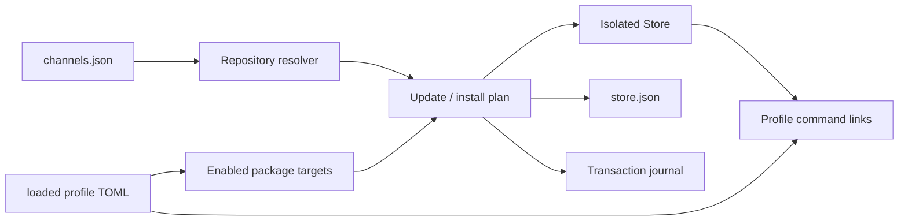

# NixFlux

<p align="center">
  
</p>

<p align="center">
  <strong>A profile-based package manager for Linux and Android/Termux</strong><br>
  Isolated Store • independent environments • PATH command management
</p>

<p align="center">
  <a href="#quick-start"><code>Quick Start</code></a>
  · <a href="#profiles"><code>Profiles</code></a>
  · <a href="#configuration"><code>Configuration</code></a>
  · <a href="#build"><code>Build</code></a>
  · <a href="docs/ARCHITECTURE.md"><code>Architecture</code></a>
</p>

NixFlux installs native Debian binary packages (`.deb`) from APT repositories into a private, isolated Store. The active package set is determined by the loaded profile, not by a global enabled list.

- Linux and Android/Termux support.
- Independent profiles with concrete package versions.
- Repository configuration through `channels.json`.
- Separate persistent-default and currently-loaded profiles.
- Bidirectional synchronization of profile commands with `PATH`.
- Atomic transactions, recovery journaling, and process locking.
- SHA-256, dependency, archive, and Store verification.

> [!IMPORTANT]
> Package payloads remain in the private Store. Only commands from the enabled list of the currently loaded profile are published to `PATH`.

## Quick Start

### Linux

```sh
go build -o nixflux ./cmd/nixflux
./nixflux channel list
./nixflux channel install https://example.org/apt/stable
./nixflux env install example:package==1.2.3
./nixflux profiles list
```

### Termux / Android

```sh
pkg install golang gpgv xz
GOOS=android GOARCH=arm64 go build -o nixflux ./cmd/nixflux
./nixflux channel list
./nixflux profiles list
```

On Android, the binary publishes managed links under `$PREFIX/bin`. On regular Linux, links use `$HOME/nix/bin`, which must be added to `PATH`.

## Build

Requirements:

- Go 1.20 or newer.
- `gpgv` to verify signed APT `Release` files.
- A trusted repository public key.
- `xz` for XZ-compressed indexes or archives. Plain, gzip, and bzip2 streams are handled internally.

```sh
go test ./...
go test -race ./...
go vet ./...
go build -o nixflux ./cmd/nixflux
```

Select a target architecture with standard Go environment variables:

```sh
GOOS=linux GOARCH=amd64 go build -o nixflux ./cmd/nixflux
GOOS=android GOARCH=arm64 go build -o nixflux ./cmd/nixflux
GOOS=android GOARCH=arm go build -o nixflux ./cmd/nixflux
```

## Profiles

A profile is an independent working environment with its own package list. Payload files remain in the shared Store; a profile stores only exact targets in `name==version` format.

```text
profiles.lock  ──► persistent default profile
.current       ──► currently loaded profile
profiles/*.toml ─► enabled packages for each profile
```

| File / marker | Purpose |
|---|---|
| `profiles.lock` | Persistent default profile used by commands without a profile name |
| `.current` | Profile whose commands are currently published to `PATH` |
| `<name>.toml` | Independent enabled package list |

### Example profile

```toml
[profile]
enabled = [
  "neofetch==7.1.0-1",
]
```

```sh
nixflux profiles install work       # create an empty profile without installing packages
nixflux profiles update work        # update and load work
nixflux profiles update             # update the persistent default from profiles.lock
nixflux profiles list               # mark the default and list profiles
nixflux profiles remove work        # remove only the profile TOML
```

`profiles update work` does not modify `profiles.lock`: a named profile update affects only the loaded environment.

## Configuration

All mutable state is stored under `$HOME/nix/`:

```text
$HOME/nix/
├── store/                  # Isolated package directories
├── staging/                # Temporary atomic transaction data
├── bin/                    # Command-link directory on regular Linux
├── set/
│   ├── channels.json       # Sole repository configuration source
│   ├── store.json          # Installed packages and metadata
│   ├── transaction.json    # Unfinished transaction journal
│   └── nixflux.lock        # Process lock
└── profiles/
    ├── profiles.lock       # Persistent default profile
    ├── .current            # Currently loaded profile
    └── <name>.toml         # Profile enabled packages
```

| Source | Role |
|---|---|
| `channels.json` | Repository and APT download configuration |
| `<name>.toml` | Active package targets for a selected profile |
| `store.json` | Physically installed Store packages and dependencies |
| `profiles.lock` | Default profile for commands without a profile name |
| `.current` | Profile that determines published commands |

During the initial migration, legacy `settings.toml` is retained as `settings.toml.migrated` or a numbered variant. `settings.toml` is no longer runtime configuration.

## Repositories

`channels.json` is the sole active repository configuration source. The channel list preserves order and repository fields:

```json
{
  "channels": [
    {
      "name": "main",
      "url": "https://mirror.example/apt/stable",
      "distribution": "stable",
      "component": "main",
      "architecture": "amd64"
    }
  ]
}
```

On Android builds, NixFlux may create the official Termux channel automatically:

```json
{
  "name": "termux",
  "url": "https://packages-cf.termux.dev/apt/termux-main",
  "distribution": "stable",
  "component": "main"
}
```

NixFlux loads `dists/<distribution>/Release`, verifies the signature with `gpgv`, and downloads a Packages index only when it matches the signed size and SHA-256 metadata.

## Installation and Store

NixFlux reads the Debian `ar` container, then `control.tar*` and `data.tar*`, validating package name, version, architecture, paths, symlinks, hardlinks, dependencies, and file checksums. Each downloaded `.deb` is verified against the signed APT Packages index SHA-256.

Package payloads are extracted into a content-addressed Store. Files are not copied into a home profile or maintained as copies inside profiles.

### Platform behavior

| Platform | Managed links | Notes |
|---|---|---|
| Linux | `$HOME/nix/bin` | The directory must be added to `PATH` |
| Android / Termux | `$PREFIX/bin` | Managed links are placed in the standard Termux `PATH` |

At startup and after profile switching, NixFlux compares the complete desired link set with existing NixFlux-managed links. Third-party binaries and links outside the NixFlux Store are not removed.

On Termux, `$PREFIX/var/lib/dpkg/status` is used only to identify dependencies already provided by the system. NixFlux does not modify the dpkg database or replace system `pkg` / APT.

## State Flow



## Package Compatibility

Implemented: `Depends`, `Pre-Depends`, alternatives, version constraints, architecture restrictions, regular files, directories, relative symlinks, supported absolute symlinks, and regular-file hardlinks.

Not implemented: maintainer scripts, triggers, conffile semantics, `Provides`, conflict/replacement semantics, `Recommends`, `Suggests`, and complete Multi-Arch rules. Packages containing unsupported files are rejected instead of being partially installed.

## Commands

```sh
nixflux --help
nixflux version

# Repositories
nixflux channel install https://mirror.example/apt/stable
nixflux channel list
nixflux channel fetch main
nixflux channel remove main

# Packages for the persistent default profile
nixflux env install main:neofetch==latest
nixflux env install main:neofetch==7.1.0-1
nixflux env list
nixflux env freeze neofetch==7.1.0-1
nixflux env frozen
nixflux env unfreeze neofetch==7.1.0-1
nixflux env remove neofetch==7.1.0-1

# Profiles
nixflux profiles list
nixflux profiles install work
nixflux profiles update work
nixflux profiles update
nixflux profiles remove work
nixflux env update
```

An exact version is required for remove, freeze, and unfreeze. A normal install does not downgrade an installed package. Downgrades selected by exact profile targets are handled by `profiles update` / `env update`. Frozen packages cannot change versions. Removing a package required by another installed NixFlux package is rejected. `env remove` also removes the package from the default profile, so a later default-profile update does not reinstall it.

## Atomicity and Recovery

Install and remove operations stage package contents and write a transaction journal before changing Store directories, entrypoint links, the package database, or a profile. The journal preserves prior profile and loaded-profile state, allowing an interrupted operation to restore configuration and package state together. Interrupted transactions are recovered by the next command. Mutating commands are serialized with a process lock.
