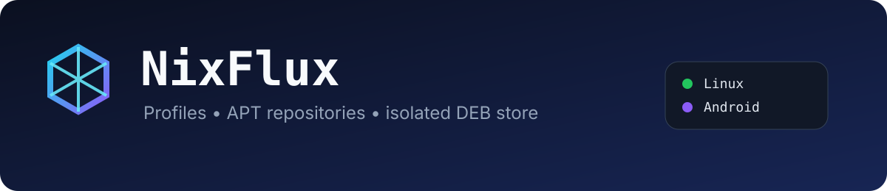
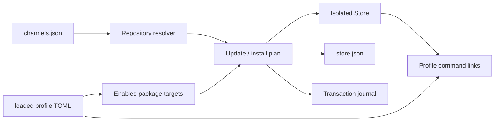

# NixFlux

<p align="center">
  
</p>

<p align="center">
  <strong>Профильный менеджер пакетов для Linux и Android/Termux</strong><br>
  Изолированный Store • независимые среды • управление командами через PATH
</p>

<p align="center">
  <a href="#быстрый-старт"><code>Быстрый старт</code></a>
  · <a href="#профили"><code>Профили</code></a>
  · <a href="#конфигурация"><code>Конфигурация</code></a>
  · <a href="#сборка"><code>Сборка</code></a>
  · <a href="docs/ARCHITECTURE.md"><code>Архитектура</code></a>
</p>

NixFlux устанавливает нативные Debian-бинарные пакеты (`.deb`) из APT-репозиториев в приватный изолированный Store. Активный набор определяется выбранным профилем, а не общим глобальным enabled-списком.

- Поддержка Linux и Android/Termux.
- Независимые профили с собственными конкретными версиями пакетов.
- Управление репозиториями через `channels.json`.
- Отдельные persistent default и currently loaded профили.
- Двусторонняя синхронизация команд профиля с PATH.
- Атомарные транзакции, журнал восстановления и блокировка процессов.
- Проверка SHA-256, зависимостей, архивов и Store-пакетов.

> [!IMPORTANT]
> Пакеты остаются в приватном Store. В PATH публикуются только команды из enabled-списка загруженного профиля.

## Быстрый старт

### Linux

```sh
go build -o nixflux ./cmd/nixflux
./nixflux channel list
./nixflux channel install https://example.org/apt/stable
./nixflux env install example:package==1.2.3
./nixflux profiles list
```

### Termux / Android

```sh
pkg install golang gpgv xz
GOOS=android GOARCH=arm64 go build -o nixflux ./cmd/nixflux
./nixflux channel list
./nixflux profiles list
```

На Android бинарник публикует managed-ссылки в `$PREFIX/bin`. Для обычного Linux используется `$HOME/nix/bin`, который должен быть добавлен в `PATH`.

## Сборка

Требования:

- Go 1.20 или новее.
- `gpgv` для проверки подписанных APT Release-файлов.
- Доверенный ключ репозитория.
- `xz` для XZ-сжатых индексов или архивов; он не нужен для plain, gzip и bzip2 потоков.

```sh
go test ./...
go test -race ./...
go vet ./...
go build -o nixflux ./cmd/nixflux
```

Разные архитектуры сборки выбираются стандартными переменными Go:

```sh
GOOS=linux GOARCH=amd64 go build -o nixflux ./cmd/nixflux
GOOS=android GOARCH=arm64 go build -o nixflux ./cmd/nixflux
GOOS=android GOARCH=arm go build -o nixflux ./cmd/nixflux
```

## Профили

Профиль — независимая рабочая среда с собственным списком пакетов. Payload-файлы остаются в общем Store; профиль хранит только точные targets вида `name==version`.

```text
profiles.lock  ──► persistent default профиль
.current       ──► currently loaded профиль
profiles/*.toml ─► enabled пакетов конкретного профиля
```

| Файл / маркер | Назначение |
|---|---|
| `profiles.lock` | Профиль по умолчанию для операций без имени |
| `.current` | Профиль, команды которого сейчас опубликованы в PATH |
| `<name>.toml` | Независимый enabled-список пакетов |

### Пример профиля

```toml
[profile]
enabled = [
  "neofetch==7.1.0-1",
]
```

```sh
nixflux profiles install work       # пустой профиль, без установки пакетов
nixflux profiles update work        # обновить и загрузить work
nixflux profiles update             # обновить persistent default из profiles.lock
nixflux profiles list               # отметить default и показать все профили
nixflux profiles remove work        # удалить только профильный TOML
```

`profiles update work` не изменяет `profiles.lock`: named profile влияет только на loaded environment.

## Конфигурация

Все mutable-состояние хранится под `$HOME/nix/`:

```text
$HOME/nix/
├── store/                  # Изолированные директории пакетов
├── staging/                # Временные данные атомарных транзакций
├── bin/                    # Линковочная директория для обычного Linux
├── set/
│   ├── channels.json       # Единственный источник репозиториев
│   ├── store.json          # Установленные пакеты и metadata
│   ├── transaction.json    # Журнал незавершённой транзакции
│   └── nixflux.lock        # Блокировка процесса
└── profiles/
    ├── profiles.lock       # Persistent default профиль
    ├── .current            # Currently loaded профиль
    └── <name>.toml         # Enabled-пакеты профиля
```

| Источник | Роль |
|---|---|
| `channels.json` | Репозитории и параметры APT-загрузки |
| `<name>.toml` | Активные package targets выбранного профиля |
| `store.json` | Физически установленные Store-пакеты и dependencies |
| `profiles.lock` | Профиль по умолчанию для операций без имени |
| `.current` | Профиль, определяющий опубликованные команды |

При первой миграции legacy `settings.toml` сохраняется как `settings.toml.migrated` (или с номерным суффиксом). Сам `settings.toml` больше не является runtime-конфигурацией.

## Репозитории

`channels.json` является единственным активным источником конфигурации репозиториев. Список каналов сохраняет порядок и поля репозитория:

```json
{
  "channels": [
    {
      "name": "main",
      "url": "https://mirror.example/apt/stable",
      "distribution": "stable",
      "component": "main",
      "architecture": "amd64"
    }
  ]
}
```

На Android сборках NixFlux может создать официальный канал Termux автоматически:

```json
{
  "name": "termux",
  "url": "https://packages-cf.termux.dev/apt/termux-main",
  "distribution": "stable",
  "component": "main"
}
```

NixFlux загружает `dists/<distribution>/Release`, проверяет подпись через `gpgv`, после чего скачивает Packages-индекс только если он соответствует подписанным размеру и SHA-256.

## Установка и Store

NixFlux читает Debian `ar`, затем `control.tar*` и `data.tar*`, проверяет имя, версию, архитектуру, пути, symlinks, hardlinks, dependencies и контрольные суммы файлов. Загруженный `.deb` проверяется по SHA-256 из подписанного APT Packages-индекса.

Package payload распаковывается в изолированный content-addressed Store. Файлы не копируются в домашний profile и не становятся копиями пакетов внутри профиля.

### Platform behavior

| Платформа | Managed-ссылки | Особенности |
|---|---|---|
| Linux | `$HOME/nix/bin` | Каталог должен быть добавлен в `PATH` |
| Android / Termux | `$PREFIX/bin` | Текущие managed-ссылки размещаются в стандартном Termux `PATH` |

При старте и после переключения профиля NixFlux сравнивает полный desired-набор ссылок с существующими managed-ссылками. Сторонние бинарники и ссылки вне NixFlux Store не удаляются.

На Termux система `$PREFIX/var/lib/dpkg/status` используется только для определения уже предоставленных system dependencies. NixFlux не изменяет dpkg-базу и не заменяет системный `pkg` / APT.

## Поток состояния



## Совместимость пакетов

Реализовано: `Depends`, `Pre-Depends`, alternatives, version constraints, architecture restrictions, regular files, directories, relative symlinks, поддерживаемые absolute symlinks и regular-file hardlinks.

Не реализовано: maintainer scripts, triggers, conffile semantics, `Provides`, conflict/replacement semantics, `Recommends`, `Suggests` и полные Multi-Arch rules. Пакеты с неподдерживаемыми файлами отклоняются вместо частичной установки.

## Команды

```sh
nixflux --help
nixflux version

# Репозитории
nixflux channel install https://mirror.example/apt/stable
nixflux channel list
nixflux channel fetch main
nixflux channel remove main

# Пакеты persistent default профиля
nixflux env install main:neofetch==latest
nixflux env install main:neofetch==7.1.0-1
nixflux env list
nixflux env freeze neofetch==7.1.0-1
nixflux env frozen
nixflux env unfreeze neofetch==7.1.0-1
nixflux env remove neofetch==7.1.0-1

# Профили
nixflux profiles list
nixflux profiles install work
nixflux profiles update work
nixflux profiles update
nixflux profiles remove work
nixflux env update
```

Требуется точная версия для удаления, заморозки и разморозки. Обычная установка не понижает версию установленного пакета. Понижения, выбранные точными целями профиля, обрабатываются `profiles update` / `env update`. Замороженные пакеты не могут менять версии. Удаление пакета, требуемого другим установленным пакетом NixFlux, отклоняется. `env remove` также удаляет этот пакет из профиля по умолчанию, чтобы последующее обновление профиля по умолчанию не переустанавливало его.

## Атомарность и восстановление

Операции установки и удаления временно сохраняют содержимое пакетов и записывают журнал транзакций перед изменением директорий хранилища, ссылок на точки входа, базы данных пакетов или профиля. Журнал хранит предыдущее состояние профиля и загруженного профиля, чтобы прерванная операция могла восстановить конфигурацию и состояние пакетов вместе. Прерванные транзакции восстанавливаются следующей командой. Мутирующие команды сериализуются с блокировкой процесса.
